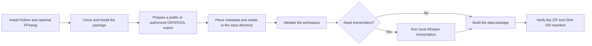

# social-content-data-packager

Package public or authorized content exports into structured, integrity-verifiable social-content archives.

[简体中文](README.md) | English

[](https://github.com/yangjing6213-dev/social-content-data-packager/actions/workflows/ci.yml) [](LICENSE)

`social-content-data-packager` turns DATATOOL exports—video, cover, page copy and comments—into a
verifiable Chinese data package. It can optionally use local Whisper to transcribe the complete audio
track of a video.

This project is intended for public-content research, authorized archiving and personal data
organization. It does not bypass login, CAPTCHA, paywalls or platform controls, and it does not upload
browser cookies, account credentials or collected data.

## Core features

- Initialize a standard task workspace and metadata template.
- Validate metadata, comment headers and real video streams.
- Transcribe a complete video soundtrack locally with Whisper and emit TXT, JSON and SRT artifacts.
- Produce a Chinese Excel workbook, a sanitized data package and SHA-256 manifest.
- Verify ZIP paths, CRC, file sets, byte counts and hashes independently.
- Exclude raw comments by default and optionally anonymize identity fields.

## Usage Workflow



1. Prepare a legal, public or explicitly authorized export.
2. Run `init` or place the required files under the Chinese `输入/` directory.
3. Edit `输入/元数据.json` with verified metadata and authorization basis.
4. Run `validate`.
5. Run `package`, optionally with `--transcribe-video` and comment anonymization.
6. Run `verify` on the generated ZIP before sharing it.

## Quick Start

```bash
git clone https://github.com/yangjing6213-dev/social-content-data-packager.git
cd social-content-data-packager
python -m venv .venv
python -m pip install -e .
social-content-packager init "My collection task"
social-content-packager validate "My collection task"
social-content-packager package "My collection task"
social-content-packager verify "My collection task/output/<package>.zip"
```

For local transcription, install the optional dependency and FFmpeg/FFprobe:

```bash
python -m pip install -e ".[transcribe]"
social-content-packager package "My collection task" --transcribe-video --model small --language zh
```

## System requirements

- Python 3.10 or newer; Python 3.10–3.12 is recommended for Whisper.
- FFmpeg and FFprobe for media validation and transcription.
- Windows, macOS and Linux are supported for the local CLI where the declared dependencies work.
- Manual DATATOOL export is optional. No GPU or database is required by the core package.

## Installation and configuration

See [installation.md](docs/installation.md) and [configuration.md](docs/configuration.md). The core
package does not require committed secrets. `.env.example` contains only blank placeholders; never commit
`.env`, cookies, signed URLs or account credentials.

## Commands

```text
social-content-packager init <task-directory>
social-content-packager doctor
social-content-packager validate <task-directory>
social-content-packager transcribe <task-directory> [--model small] [--language zh]
social-content-packager package <task-directory> [--transcribe-video] [--anonymize-comments]
social-content-packager verify <package.zip>
```

Use `social-content-packager <command> --help` for the installed version. Do not assume an unavailable
command or platform adapter is supported.

## Project structure

```text
src/social_content_data_packager/  Python package and CLI
tests/                              automated tests
examples/                           synthetic metadata examples
docs/                               workflow, architecture and release documentation
.github/                            CI, CodeQL, Dependabot and community templates
```

## Documentation

- [Installation](docs/installation.md)
- [Configuration](docs/configuration.md)
- [Architecture](docs/architecture.md)
- [Troubleshooting](docs/troubleshooting.md)
- [DATATOOL workflow](docs/DATATOOL_WORKFLOW.md)
- [Releasing](docs/releasing.md)
- [Repository standard](docs/REPOSITORY_STANDARD.md)

## FAQ

**Can I use the package without DATATOOL?** Yes. Existing compliant local exports can use `init`,
`validate`, `package` and `verify` without browser collection.

**Does it bypass login or CAPTCHA?** No. The user completes those steps in an isolated browser.

**Is a transcript official?** No. Whisper output is automatic and must be reviewed for names, numbers
and specialist terms.

## Roadmap

- Done: standard workspaces, media/metadata/comment validation, package verification and local transcription.
- In progress (excluded from this release candidate): exploratory browser-assisted collection.
- Planned: additional authorized export formats and platform adapters; compatibility is not promised.
- Visual assets may be added later if branding or presentation needs justify them.

## Contributing, security and support

- Contributions: [CONTRIBUTING.md](CONTRIBUTING.md)
- Security reports: [SECURITY.md](SECURITY.md); do not disclose sensitive details in public issues.
- Support: [SUPPORT.md](SUPPORT.md)
- Code of conduct: [CODE_OF_CONDUCT.md](CODE_OF_CONDUCT.md)

## License and acknowledgements

This project is released under the [MIT License](LICENSE). It uses third-party software such as
[openpyxl](https://openpyxl.readthedocs.io/), [Playwright](https://playwright.dev/) and optional
[OpenAI Whisper](https://github.com/openai/whisper); review their licenses and attribution requirements.
DATATOOL is an independent third-party product and is not represented as an official partner.

## Development

```bash
python -m pip install -e ".[dev]"
python -m ruff check .
python -m mypy
python -m pytest --cov
python -m build
```

See [AGENTS.md](AGENTS.md) and [CONTRIBUTING.md](CONTRIBUTING.md) before changing the repository.
