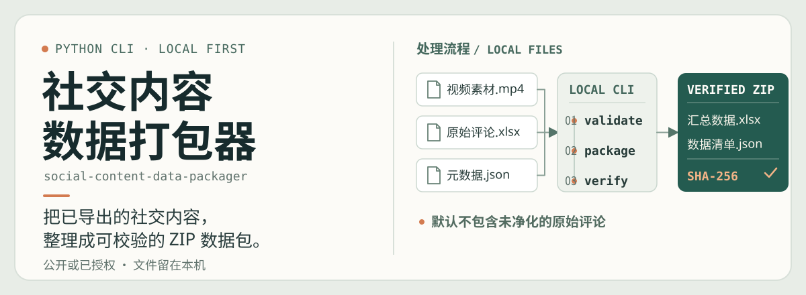
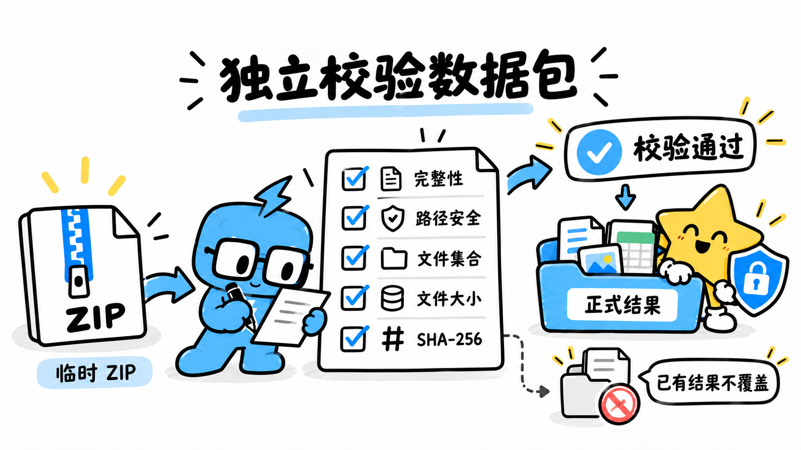
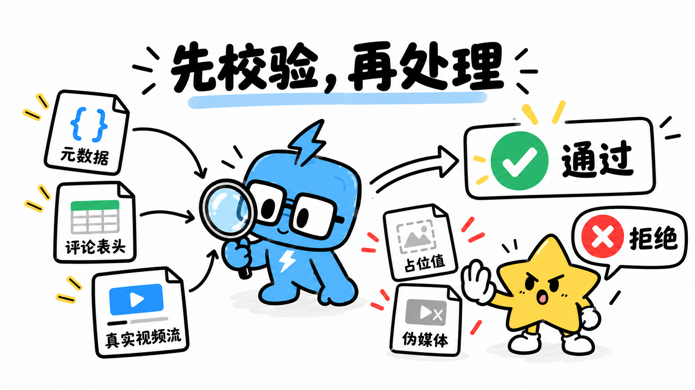

# 社交内容数据下载打包器

**social-content-data-packager**

[](https://github.com/yangjing6213-dev/social-content-data-packager/blob/main/LICENSE)
[](https://www.python.org/) [](https://openpyxl.readthedocs.io/)
[](https://ffmpeg.org/) [](https://pypi.org/project/openai-whisper/)

给需要整理社交平台导出资料的 AI 创作者和内容整理者，把已获授权的视频、页面文案和评论汇成可编辑、可核对的 Excel 与 ZIP 数据包。

下载回来的视频、评论和页面信息常常散落在不同文件里。这个工具在本机按统一目录检查素材、整理数据并生成文件清单；平台登录、导出内容和确认授权仍由你自己完成。

简体中文 | [English](README.en.md)

*封面与流程插画含有生成式 AI 内容，已结合项目实际功能核对；图示仅供说明，不代表真实程序界面或运行结果，项目内容由维护者负责。*



## 目录

[项目是什么](#1-这个项目是什么) · [先看效果](#2-先看效果) · [适合谁用](#3-适合谁用) · [安装与第一次使用](#6-安装与快速开始) · [如何使用](#7-如何使用) · [注意事项](#10-注意事项与常见问题) · [版本与作者](#11-版本说明)

## 1. 这个项目是什么

这是一款在你的电脑上运行的 Python 命令行工具。命令行就是输入文字指令的窗口，例如 Windows 的 PowerShell 或 macOS/Linux 的终端。你把已经导出的本地文件放进任务目录，它会检查必需信息，并生成汇总表、ZIP 数据包和 SHA-256 文件清单。SHA-256 是用来核对文件内容有没有变化的一种校验值。

项目主要面向 DATATOOL 导出的资料；只要本地文件符合项目要求，也可以由你通过其他有权使用的方式取得。它不会替你登录平台或自动采集内容。

## 2. 先看效果

仓库目前提供的是字段示例，没有真实用户的视频、评论或完整数据包截图。下图是流程插画，帮助理解 ZIP 和文件清单如何配合；它不是程序运行截图，也不代表一次真实校验结果。



*流程插画：打包后可以运行 `verify` 检查 ZIP 内容、文件清单和 SHA-256。实际结果以你运行命令后看到的提示为准。*

## 3. 适合谁用

### 特别适合

- 已经有公开或已获授权的社交内容导出文件，想把视频、页面信息和评论整理到一起的人。
- 需要保存一份可继续编辑的 Excel，并希望之后能检查 ZIP 是否缺文件或内容发生变化的人。
- 愿意按说明复制几条命令、在本机准备文件的 AI 创作者或内容运营者。

### 不适合

- 希望工具自动登录、下载或采集平台内容的人；当前稳定命令行没有自动采集功能。
- 只想用图形界面点选、不愿安装 Python 和视频工具的人。
- 希望工具替自己判断授权、版权或评论内容是否适合公开的人；这些需要你自己确认。

## 4. 你会得到什么

成功打包后，ZIP 默认保存在任务目录的 `输出/` 文件夹中。文件名包含内容标题和生成时间，命令也会打印 ZIP 的完整路径。

包内通常包括：

- `汇总数据.xlsx`：可以用 Excel 或 WPS 打开并继续整理。
- `元数据.json` 和 `笔记文案.txt`：保存内容信息和页面文案。
- `视频素材.mp4`，以及你提供的封面图片（如果有）。
- `使用说明.txt` 和 `数据清单.json`：说明包内内容，并记录文件名、大小和 SHA-256。
- 如果有有效转写分段，还会包含完整口播文案、时间轴字幕 `.srt` 和分段 JSON。

原始评论工作簿默认不放进 ZIP。汇总 Excel 仍可能含评论内容，隐私处理方式见[注意事项](#10-注意事项与常见问题)。

## 5. 它能帮你解决什么问题

手动整理时，视频、页面文案、评论和封面容易分散保存，也不容易确认最后的压缩包是否完整。这个工具把必需文件放在固定位置，先检查再打包，并留下可复核的清单。

你仍要自己取得有权使用的素材、补全元数据、检查转写和评论隐私，并决定是否分享数据包。项目不会自动节省某个固定时长，也不能保证导出内容完整或准确。

## 6. 安装与快速开始

### 开始前准备

- **必需：** Python 3.10 或更新版本；仓库的自动检查覆盖 Python 3.10–3.12，第一次安装建议选 3.12。还需要 FFmpeg 和 FFprobe；`doctor` 会检查两者能否在终端中运行，FFprobe 用于检查视频流，FFmpeg 用于视频转写。
- **素材：** `元数据.json` 和 `视频素材.mp4`。原始评论表、封面和已有转写文件可选。
- **可选：** 本地 Whisper 转写需要额外安装；项目说明支持 Python 3.10–3.12。识别在你的电脑上运行，不需要 OpenAI API 密钥（在线服务的访问凭证）；首次安装依赖或下载识别模型需要联网。

项目自身采用 MIT 许可证。若你已经有符合要求的文件，不需要安装 DATATOOL；若要用它导出素材，需要另外安装浏览器扩展并按其规则登录。仓库没有提供 DATATOOL 服务的价目表；账号等级可能影响可用导出功能，请在使用前查看[官方安装与功能说明](https://www.datatool.vip/downloader/install-plugin/zh)。

### Windows 安装

先从 GitHub 项目页选择 **Code → Download ZIP**，解压后进入含有 `pyproject.toml` 的项目文件夹。下载并解压还没有完成安装。请在文件夹空白处打开 PowerShell，复制运行下面的命令。它会在项目文件夹里创建独立环境、安装项目和必需的 OpenPyXL，然后检查 FFmpeg 与 FFprobe：

```powershell
python -m venv .venv
.\.venv\Scripts\python.exe -m pip install -e .
.\.venv\Scripts\social-content-packager.exe doctor
```

看到 `通过：FFmpeg` 和 `通过：FFprobe` 表示视频检查工具已就绪。若显示缺少，请按 [FFmpeg 官方下载页](https://ffmpeg.org/download.html)为你的系统安装，并重新打开 PowerShell 检查。Whisper 显示缺少不会影响普通打包。

### macOS / Linux 安装

在解压后的项目文件夹中打开终端，运行：

```bash
python3 -m venv .venv
source .venv/bin/activate
python -m pip install -e .
social-content-packager doctor
```

看到 FFmpeg 和 FFprobe 检查通过后即可继续。安装 Python 的入口见 [Python 官方下载页](https://www.python.org/downloads/)，视频工具见 [FFmpeg 官方下载页](https://ffmpeg.org/download.html)。

### 第一次整理一个任务

以下示例以 Windows PowerShell 为例。先在项目文件夹中创建任务目录：

```powershell
.\.venv\Scripts\social-content-packager.exe init "我的任务"
```

命令会创建 `我的任务\输入\` 和 `我的任务\输出\`。把 `元数据.json` 中的示例值改成真实内容，再把 `视频素材.mp4` 放入 `输入` 文件夹。字段可参考 [`examples/元数据示例.json`](examples/元数据示例.json)，但示例里的作者、链接和互动数据都是虚构内容，不能原样当作真实记录使用。评论表和封面按需放入同一文件夹。

先检查输入：

```powershell
.\.venv\Scripts\social-content-packager.exe validate "我的任务"
```

看到 `输入校验通过` 后再生成数据包：

```powershell
.\.venv\Scripts\social-content-packager.exe package "我的任务"
```

成功时，终端会显示 ZIP 的完整路径。把这条实际路径放在下面命令的引号中，检查生成结果：

```powershell
.\.venv\Scripts\social-content-packager.exe verify "把这里替换为上一步显示的 ZIP 完整路径"
```

看到 `数据包校验通过` 表示压缩包和清单中的文件通过了程序检查；它不代表内容授权或内容事实已经被核实。

macOS / Linux 用户在上方安装步骤激活 `.venv` 后，使用下面的命令完成同样流程：

```bash
social-content-packager init "我的任务"
social-content-packager validate "我的任务"
social-content-packager package "我的任务"
social-content-packager verify "把这里替换为上一步显示的 ZIP 完整路径"
```

## 7. 如何使用

日常整理按“准备输入 → 校验 → 打包 → 再校验 ZIP”进行。每个新任务使用单独文件夹；修改素材或元数据后，重新运行 `validate` 和 `package`。

### 可选：转写视频口播

先在项目文件夹安装转写依赖。Windows PowerShell 使用：

```powershell
.\.venv\Scripts\python.exe -m pip install -e ".[transcribe]"
```

再运行：

```powershell
.\.venv\Scripts\social-content-packager.exe package "我的任务" --transcribe-video --model small --language zh
```

也可以单独执行 `transcribe`；生成的 TXT、SRT 和分段 JSON 会放在任务的 `输入/` 文件夹。自动识别可能听错人名、品牌名、数字和日期；它不会读取画面里没有读出来的文字。分享或使用前请人工复核。已有转写文件时，程序默认不覆盖。

macOS / Linux 用户在已激活的虚拟环境中运行：

```bash
python -m pip install -e ".[transcribe]"
social-content-packager package "我的任务" --transcribe-video --model small --language zh
```


*流程插画，不是实际转写截图。打包时启用转写，ZIP 会收录有效的 TXT、SRT 与分段 JSON。*

其他输入格式和 DATATOOL 导出步骤见[工作流说明](docs/DATATOOL_WORKFLOW.md)，常见问题见[排障指南](docs/troubleshooting.md)。

## 8. 项目工作流程

1. **你准备素材：** 从公开内容、本人内容或明确授权的内容中取得文件，并填写元数据。
2. **你整理目录：** `init` 创建模板；你把必需视频、元数据和可选文件放入 `输入/`。
3. **程序检查：** `validate` 检查元数据、视频流和可选文件格式。
4. **程序打包：** `package` 生成 Excel、ZIP 和 SHA-256 文件清单，并在返回数据包前检查压缩包。
5. **你复核结果：** `verify` 独立核对 ZIP；你再检查 Excel、评论隐私、转写和授权记录。


*流程插画，不是程序界面。素材由你自己导出并放入目录；项目不会替你获取或判断授权。*

## 9. 项目目录结构

运行 `init` 后，一个任务目录大致如下：

```text
我的任务/
├── 输入/
│   ├── 元数据.json                  必需：内容与授权信息
│   ├── 视频素材.mp4                 必需：待整理的视频
│   ├── 原始评论.xlsx                可选：评论表
│   ├── 封面图片.webp                可选：也支持 jpg、jpeg、png
│   └── 视频文案（分段数据）.json     可选：已有的转写分段
└── 输出/                            打包后生成 ZIP
```

仓库中的 [`examples/元数据示例.json`](examples/元数据示例.json) 只用于查看字段；`docs/DATATOOL_WORKFLOW.md` 说明如何准备导出文件。一般使用者不需要修改 `src/` 中的程序文件。

## 10. 注意事项与常见问题

### 评论与隐私


*这张插画中“默认只放安全化评论”并非程序的实际默认行为。实际情况是：ZIP 默认不包含未经净化的原始评论工作簿；汇总 Excel 仍可能保留评论和身份字段。需要处理身份字段时，请显式使用 `--anonymize-comments`。*

- 只有确实需要保留原始评论工作簿时才使用 `--include-raw-comments`。它会把未经净化的工作簿放进 ZIP；此选项不能和 `--anonymize-comments` 同时使用。
- `--anonymize-comments` 处理汇总 Excel 中的评论身份字段，不等于删除评论正文。
- ZIP 文件本身不加密。分享前检查评论、元数据和视频，并通过可信渠道传送。
- `verify` 检查压缩包结构、文件集合、文件大小与 SHA-256；它不判断授权、版权、评论真实性或内容是否适合公开。

### 校验会检查什么



*流程插画中的“占位值／伪媒体”是提醒示意，不代表程序能够识别素材真假。实际校验会检查必需元数据、评论表头，并确认视频文件含有效的视频流；授权和来源仍需你核实。*

### 常见问题

- **提示缺少视频或元数据：** 确认文件名分别是 `视频素材.mp4` 和 `元数据.json`，并放在任务的 `输入/` 文件夹中。
- **`init` 提示目录非空：** 换一个新的任务目录名；程序不会清空已有文件。
- **提示元数据仍是占位值：** 把 `元数据.json` 里“请填写”内容替换成真实记录；示例文件不能直接作为真实采集记录。
- **视频校验失败：** 确认安装了 FFmpeg 和 FFprobe，并检查视频是否能正常播放。项目只验证视频流，不判断来源。
- **只想打包，不做转写：** 不用安装 Whisper。若要转写，再按上方说明安装可选依赖。
- **提示 ZIP 文件已存在：** 程序不会覆盖旧 ZIP。稍后重新生成或使用新的任务目录。
- **提示转写文件已存在：** 确认要替换时，单独转写使用 `--force`；打包时转写使用 `--force-transcript`。

仅处理你有权使用的资料，并遵守平台规则和适用法律。项目不读取 DATATOOL 账号、浏览器 Cookie 或登录资料；自动采集命令 `collect` 不属于当前稳定命令行。

## 11. 版本说明

仓库版本文件 [`pyproject.toml`](pyproject.toml) 当前标注为 `1.0.0`。[`CHANGELOG.md`](CHANGELOG.md) 记录了 `1.0.0` 稳定版本及其更新；目前可用命令为 `init`、`doctor`、`validate`、`transcribe`、`package` 和 `verify`。开发中的 `collect` 尚未作为稳定功能提供。

## 12. 相关项目

- [DATATOOL](https://www.datatool.vip/downloader/install-plugin/zh)：用于在浏览器中导出素材；本项目接收你已经保存到本机的文件。浏览器安装方式和可用功能请以 DATATOOL 官方说明为准，也可查看仓库的[导出工作流](docs/DATATOOL_WORKFLOW.md)。

## 13. 关于作者

**Enhe（恩禾）｜产品设计师 · 一人公司实践者 · AI Builder**

用 AI 打造一人公司。

- GitHub：[yangjing6213-dev](https://github.com/yangjing6213-dev)
- X / Twitter：[Amenenhe_ai](https://x.com/Amenenhe_ai/)
- 网站：[恩禾 ENHE AI](https://www.enhe-tech.com.cn/)
- 微信：Hu-Amen
- 邮箱：[amen.enhe@gmail.com](mailto:amen.enhe@gmail.com)

## 14. 继续探索

我把这个工具做成一个本地整理流程，希望把分散的社交内容导出文件变成容易检查、继续整理的数据包。如果你也在用 AI 做内容或搭建自己的工作流，欢迎到我的网站看看：

[访问恩禾 ENHE AI](https://www.enhe-tech.com.cn/)

更多项目说明见[安装指南](docs/installation.md)、[安全与隐私说明](SECURITY.md)、[支持渠道](SUPPORT.md)和[贡献指南](CONTRIBUTING.md)。本项目采用 [MIT 许可证](LICENSE)。
