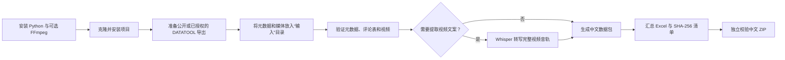

# social-content-data-packager

将公开或已授权的导出内容整理为结构清晰、可校验完整性的社交内容数据包。

简体中文 | [English](README.en.md)

[](https://github.com/yangjing6213-dev/social-content-data-packager/actions/workflows/ci.yml) [](LICENSE)

`social-content-data-packager` 将 DATATOOL 导出的社交平台视频、封面、页面文案和评论整理为一个可校验的中文数据包，并可使用本地 Whisper 从视频完整音轨中提取从头到尾的口播和对白。

本项目适合公开内容研究、已获授权的内容归档和个人数据整理。它不绕过登录、验证码、付费权限或平台风控，也不会上传浏览器 Cookie、账号凭据或采集数据。

> DATATOOL 是独立的第三方产品，需要使用者自行下载和登入。

## 功能

- 初始化标准任务目录和元数据模板。
- 接收 DATATOOL 导出的评论工作簿、视频和封面。
- 使用本地 OpenAI Whisper 处理完整视频音轨，生成完整口播文案、SRT 和分段 JSON。
- 生成包含“元数据”“评论数据”“视频文案”的中文 Excel 工作簿。
- 校验元数据、评论表头和真实视频流，拒绝占位值与伪媒体。
- 生成中文文件名的数据包、说明文件和 SHA-256 清单，并可独立复核。
- 将元数据、评论和视频文案统一按安全文本写入 Excel，避免公式注入。
- 默认排除未净化原始评论，可选择身份字段脱敏或显式包含原始工作簿。
- 使用临时 ZIP 完成校验后再发布最终文件，不静默覆盖已有结果。
- 不把媒体、评论、登录 profile 或临时浏览器文件提交到 Git。

## DATATOOL 下载

以下为 DATATOOL 网站和浏览器商店的公开入口。第三方页面可能随时调整，
请在安装前自行确认域名、发布者、权限和当前服务条款：

- [DATATOOL 官方网站](https://www.datatool.vip/?from=extension)
- [浏览器扩展安装指南](https://www.datatool.vip/downloader/install-plugin/en-us)
- [Chrome Web Store](https://chromewebstore.google.com/detail/datatool-downloader/dcembjiicioienepbaldihjhmkedagee)
- [Microsoft Edge Add-ons](https://microsoftedge.microsoft.com/addons/detail/datatool-downloader/fnojafohdfhmnkbjonengkcfclhkbkcm)
- [Firefox Add-ons](https://addons.mozilla.org/en-US/firefox/addon/datatool-downloader/)

浏览器、扩展版本、账号套餐和目标平台不同，可用的导出类型可能不同。部分完整功能需要按照官方安装指南手动安装扩展，请以 DATATOOL 当前页面和服务条款为准。

## 使用流程（稳定候选不含 `collect`）



### 自动采集（开发中，排除在本次 Release Candidate 之外）

`collect` / `collector.py` 仍是本地开发内容，不属于本次稳定候选。它需要用户自行安装
DATATOOL、创建独立 Edge/CDP 会话并完成登录、验证码和授权确认；发布前不得将其描述为已发布、
跨平台稳定或已完成的功能。当前候选只验证已有导出文件的 `init`、`validate`、`transcribe`、
`package` 和 `verify` 流程。

## 环境要求

- Python 3.10 或更高版本。使用 Whisper 时建议 Python 3.10 至 3.12。
- 手工导出流程需要用户自行安装 DATATOOL 浏览器扩展；本次候选不包含浏览器自动采集。
- 仅开发中的 `collect` 试验需要 `.[browser]`；Whisper 转写使用 `.[transcribe]`。
- FFmpeg 和 FFprobe。仅打包已有文件时可以不安装 Whisper。
- 可选：OpenAI Whisper，用于本地视频转写。

Windows 可通过 WinGet 安装 FFmpeg：

```powershell
winget install Gyan.FFmpeg
```

macOS 可使用 Homebrew：

```bash
brew install ffmpeg
```

## 安装项目

```bash
git clone https://github.com/yangjing6213-dev/social-content-data-packager.git
cd social-content-data-packager
python -m venv .venv
```

> Windows 上需要本地 Whisper 转写时，推荐安装 Python 3.12，并使用
> `py -3.12 -m venv .venv` 替代上面的建环境命令。项目已验证的 Whisper
> 环境为 Python 3.10 至 3.12。

Windows PowerShell：

```powershell
.\.venv\Scripts\Activate.ps1
python -m pip install --upgrade pip
pip install -e .
```

macOS / Linux：

```bash
source .venv/bin/activate
python -m pip install --upgrade pip
pip install -e .
```

需要视频转写时安装可选依赖：

```bash
pip install -e ".[transcribe]"
```

检查环境：

```bash
social-content-packager doctor
```

## 快速开始

### 1. 初始化任务

```bash
social-content-packager init "我的采集任务"
```

目录结构：

```text
我的采集任务/
├── 输入/
│   ├── 元数据.json
│   └── 放置采集文件说明.txt
└── 输出/
```

### 2. 使用 DATATOOL 导出

在正常浏览器窗口中登录目标平台和 DATATOOL，只采集公开或已获授权的内容。将文件放入 `输入` 目录并改为以下名称：

```text
输入/
├── 元数据.json                 必需
├── 视频素材.mp4                必需
├── 原始评论.xlsx               可选
├── 封面图片.webp               可选，也支持 jpg/jpeg/png
└── 视频文案（分段数据）.json    可选，可由下一步生成
```

使用 DATATOOL 导出评论时，可根据需要选择“包含子评论”。DATATOOL 可能把主评论和回复扁平化到同一张表，也可能因为内容删除、审核或接口限制导致页面数量与导出数量存在少量差异。

详细步骤见 [DATATOOL 工作流](docs/DATATOOL_WORKFLOW.md)。

### 3. 编辑元数据

打开 `输入/元数据.json`，填写平台、内容编号、标题、作者、页面正文、
公开链接和授权依据。授权依据只能是“公开内容”“本人所有”或“明确授权”。
建议同时记录 ISO 8601 采集时间和 DATATOOL 版本。参考
[元数据示例](examples/元数据示例.json)。

### 4. 验证输入

```bash
social-content-packager validate "我的采集任务"
```

该命令使用 FFprobe 确认 MP4 含视频流，并检查元数据、评论表头和转写分段。

### 5. 提取完整视频口播并打包（推荐）

```bash
social-content-packager package "我的采集任务" \
  --transcribe-video \
  --model small \
  --language zh \
  --initial-prompt "人工智能、隐私安全、产品名称"
```

Windows PowerShell 可以写成单行：

```powershell
social-content-packager package "我的采集任务" --transcribe-video --model small --language zh --initial-prompt "人工智能、隐私安全、产品名称"
```

该命令会把完整的 `视频素材.mp4` 交给本地 Whisper，从头到尾处理音轨，然后校验并生成数据包。这里的“视频文案”是口播和对白，不是标题、简介或页面正文；仅显示在画面中但没有读出的文字需要另行使用 OCR。

`tiny` 模型速度较快，`small` 模型中文准确率通常更好。CPU 转写可能比视频播放时间更长。自动文案不是作者官方字幕，发布或分析前应人工复核品牌名、数字和专有名词。已有文案文件默认不会被覆盖；确认替换时增加 `--force-transcript`。

只想先生成转写文件并人工校对时，可继续使用独立命令：

```bash
social-content-packager transcribe "我的采集任务" --model small --language zh
```

独立转写命令确认覆盖时使用 `--force`。

### 6. 使用已有转写或不转写时生成数据包

```bash
social-content-packager package "我的采集任务"
```

默认只把安全化评论写入 `汇总数据.xlsx`。需要脱敏评论人、用户名、位置等
身份字段时使用：

```bash
social-content-packager package "我的采集任务" --anonymize-comments
```

只有确需保留原始导出时，才显式增加 `--include-raw-comments`；该文件会命名为
`原始评论（未净化）.xlsx`。脱敏与包含未净化原始评论不能同时启用。

ZIP 将写入 `我的采集任务/输出`。包内可能包含：

```text
使用说明.txt
元数据.json
封面图片.webp
数据清单.json
汇总数据.xlsx
笔记文案.txt
视频文案.txt
视频文案（分段数据）.json
视频文案（时间轴）.srt
视频素材.mp4
```

只有存在有效转写分段时，数据包才会包含三个 `视频文案` 文件。未运行转写时不会生成空文案文件，`使用说明.txt` 会明确记录本次未提取完整视频口播。

`数据清单.json` 同时记录格式版本、CLI 版本、Git 提交、Python/操作系统、
平台、采集时间、授权依据、DATATOOL 版本和隐私处理状态。

### 7. 独立校验数据包

```bash
social-content-packager verify "输出/社交内容数据包_标题_时间.zip"
```

校验会检查 ZIP CRC、路径安全、文件集合、字节数和每个文件的 SHA-256。

## 命令

```text
social-content-packager init <任务目录>
social-content-packager doctor
social-content-packager validate <任务目录>
social-content-packager transcribe <任务目录> [--model small] [--language zh] [--force]
social-content-packager package <任务目录> [--transcribe-video] [--model small] [--language zh] [--force-transcript] [--anonymize-comments] [--include-raw-comments]
social-content-packager verify <数据包.zip>
```

也可以不安装命令行入口，直接运行：

```bash
python -m social_content_data_packager --help
```

## 数据与合规

- 仅采集公开内容、本人内容或明确授权内容。
- 遵守目标平台服务条款、robots 规则、版权要求和适用法律。
- 不要把浏览器 profile、Cookie、账号密码、扩展账号或带签名的临时下载链接提交到仓库。
- 评论可能包含用户名、位置和用户生成内容，应限制访问并避免额外传播。
- 默认交付不包含未净化的原始评论工作簿；对外分享时优先使用脱敏选项。
- 本工具不提供验证码破解、登录绕过、反爬绕过或批量骚扰能力。

详见 [安全与隐私说明](SECURITY.md)。

## 在 Codex 中调用（开发中）

仓库级 Skill `.agents/skills/popular-platform-data-collection` 与 `collect` CLI 仍在开发，排除在本次
Release Candidate 之外，不能作为稳定发布入口。当前候选只支持先由用户完成合法导出，再使用
`init`、`validate`、`transcribe`、`package` 和 `verify` 处理本地文件。开发中的浏览器流程仍不得
读取既有 Cookie、浏览器 profile、密码或令牌，也不得绕过登录、验证码或平台限制。

## Skill 化

浏览器自动采集要求有头的独立 Edge/CDP 会话和已安装的 DATATOOL 扩展；登录状态和采集数据不会写入 Skill 或 Git。

项目正在开发独立的 Codex Skill 包装层；它不属于本次候选。设计方向仍是“智能体编排层 + 本项目
CLI”，不把浏览器扩展、登录状态和采集数据塞进 Skill。打包和转写部分可自动化；任何浏览器采集
都必须由用户完成扩展安装、登录、验证码和授权确认。

完整分析见 [Skill 可行性分析](docs/SKILL_FEASIBILITY.md)，当前平台验证范围见
[平台兼容矩阵](docs/PLATFORM_COMPATIBILITY.md)。

## 文档导航

- [安装说明](docs/installation.md)
- [配置说明](docs/configuration.md)
- [架构说明](docs/architecture.md)
- [DATATOOL 工作流](docs/DATATOOL_WORKFLOW.md)
- [排障指南](docs/troubleshooting.md)
- [发布流程](docs/releasing.md)
- [仓库标准](docs/REPOSITORY_STANDARD.md)

## 常见问题

### 必须使用 DATATOOL 吗？

开发中的自动采集需要 DATATOOL，但不属于本次候选。如果已有符合格式的本地导出，可以使用
`init`、`validate`、`package` 和 `verify`，不需要浏览器自动采集。

### 项目会绕过登录或验证码吗？

不会。登录、验证码、授权确认和平台条款责任由使用者本人完成；项目不读取正常浏览器 profile、
Cookie、密码或令牌。

### 为什么转写结果需要人工复核？

Whisper 是本地自动转写，品牌名、数字和专有名词可能存在识别误差；发布或分析前应人工检查。

## Roadmap

- ✅ 已完成：标准任务目录、媒体/元数据/评论校验、数据包验证和本地转写。
- 🚧 开发中：小红书单条内容的独立 Edge/CDP 自动采集适配。
- 📌 计划中：其他平台适配和更多经授权的导出格式；尚未承诺兼容性。
- 未来可根据项目品牌与展示需求补充视觉资产。

## 贡献、支持与致谢

- 贡献流程：[CONTRIBUTING.md](CONTRIBUTING.md)
- 安全漏洞：[SECURITY.md](SECURITY.md)
- 支持渠道：[SUPPORT.md](SUPPORT.md)
- 行为准则：[CODE_OF_CONDUCT.md](CODE_OF_CONDUCT.md)

项目使用 [openpyxl](https://openpyxl.readthedocs.io/)、[Playwright](https://playwright.dev/)
和可选的 [OpenAI Whisper](https://github.com/openai/whisper) 等第三方软件；请按其各自许可证和
项目中的版权/归属要求使用。DATATOOL 是独立的第三方产品，不代表本项目官方关联。

## 开发与测试

```bash
pip install -e ".[dev]"
python -m ruff check .
python -m mypy
python -m pytest --cov
python -m build
```

GitHub Actions 会在 Windows 和 Ubuntu 的 Python 3.10、3.11、3.12 环境运行
测试、覆盖率、Ruff、Mypy 和构建检查，并单独运行依赖漏洞审计。

## 许可证

[MIT License](LICENSE)
